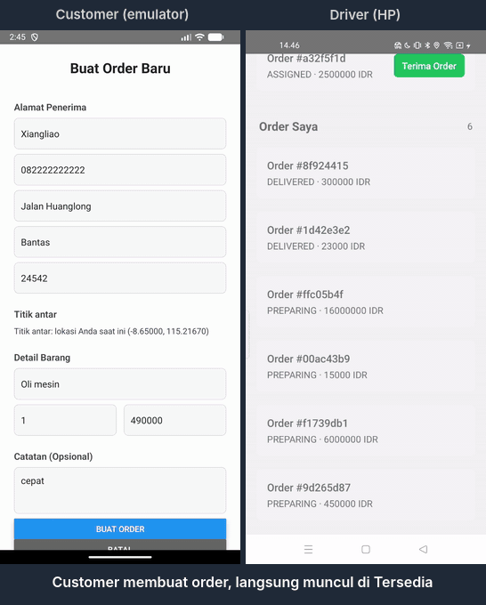
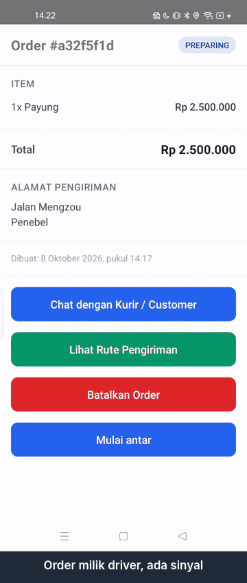

# delivery

App kurir buat Bali. Customer dan driver pakai app yang sama, perannya dipilih pas daftar.
Yang paling saya kejar: app tetap bisa dipakai driver walau sinyal hilang di jalan. Order, peta,
rute, dan chat tetap ada, dan aksi yang aman diantre terkirim sendiri begitu sinyal balik.

React Native (Android), NestJS, PostgreSQL + Prisma, WatermelonDB, socket.io, MapLibre.

<p>
  
  
</p>

Kiri: customer (emulator) bikin order, driver (HP) terima, mulai antar, terima uang tunai, selesai.
Status di layar customer berubah sendiri tanpa dimuat ulang. Kanan: driver batalin order pas Wi-Fi
dan data mati, pembatalannya nunggu di antrean, lalu terkirim sendiri begitu Wi-Fi nyala dan order
balik ke Tersedia.

## Cara kerjanya

Layar di app baca dari database lokal (WatermelonDB, SQLite), bukan langsung dari respons API,
jadi app yang dibuka tanpa sinyal tetap nampilin order terakhir. Sinkron jalan tiap 30 detik:
tarik perubahan dari server pakai cursor per perangkat, kirim perubahan lokal. Tiap baris punya
`version` di server. Kalau versi yang dikirim udah basi, server balas konflik plus data terbarunya.

Aksi driver nggak semuanya boleh diantre. Batal dan catat COD masuk tabel `pending_actions` dan
dikirim berurutan pas online. Terima order sengaja harus online, karena itu rebutan sama driver
lain. Kalau ikut diantre, dua driver bisa sama-sama ngira dapet order yang sama.

Status dan pemilik order cuma bisa berubah lewat endpoint REST (buat, terima, ubah status, batal,
COD), masing-masing dicek peran dan versinya. Push sinkron dari app untuk order dan pembayaran
ditolak server, dan jumlah COD diambil dari total order di server, bukan dari app.

Order baru langsung masuk daftar Tersedia. Order yang dibatalin driver, atau yang drivernya nggak
aktif 15 menit (50 menit kalau udah di jalan), dibalikin ke daftar itu lewat satu fungsi yang sama,
lalu driver lain dikabarin lewat socket.

Event order ke customer dan chat lewat socket.io. Socket nyoba nyambung lagi terus tanpa batas, dan
tiap nyambung daftar Tersedia diambil ulang. Pesan chat yang ditulis tanpa sinyal ikut sinkron
biasa, pengirim dan waktunya ditentuin server.

Peta pakai tile server sendiri (tileserver-gl, data OSM Bali dibikin pakai planetiler). Area
Denpasar, Kuta, dan Ubud bisa diunduh buat dipakai tanpa sinyal. Rute dari GraphHopper, rute yang
udah tampil tetap ada pas offline.

`packages/shared` isinya tipe dan kontrak event yang dipakai backend dan mobile.

## Menjalankan

Semua masih jalan lokal, belum ada yang di-deploy. Saya pakai Windows, Node 20, pnpm 9, Docker
Desktop, emulator Android Studio, dan satu HP Android. iOS belum pernah dicoba.

```
pnpm install
pnpm build:shared
docker compose up -d
```

Data peta dibikin sekali (butuh bash dan Docker, unduhan pertamanya lumayan besar), lalu tile
server jalan di port 8080:

```
cd infra/tileserver
./refresh-osm.sh
docker compose up -d
```

Backend: salin `apps/backend/.env.example` jadi `apps/backend/.env`, isi `JWT_SECRET` pakai
string acak.

```
cd apps/backend
pnpm exec prisma generate
pnpm exec prisma migrate deploy
pnpm start:dev
```

Mobile: salin `apps/mobile/.env.example` jadi `apps/mobile/.env`. `GRAPHHOPPER_API_KEY` diisi kalau
mau rute (kuncinya gratis dari graphhopper.com).

```
cd apps/mobile
pnpm android
```

Alamat di `.env.example` buat emulator (`10.0.2.2`). Buat HP asli, `API_BASE_URL` dan
`TILE_BASE_URL` harus alamat PC yang bisa dijangkau HP. Saya pakai Tailscale karena PC dan HP beda
jaringan. Env dibaca pas build, jadi abis diganti harus build ulang, reload Metro nggak cukup.

Akun dibuat dari layar daftar di app. Peta offline diunduh dari Settings di layar peta.

Tes: `pnpm --filter @delivery/backend test`, `pnpm --filter @delivery/mobile test`, dan
`pnpm typecheck`. Tes e2e backend (`test:e2e`) pakai database dari `.env` yang sama, jadi jangan
dijalankan ke database yang datanya penting.

## Yang lagi dikerjakan

- Order yang dipindah ke driver lain pas driver lama offline. Driver lama dikasih tahu, dan aksi
  yang masih antre buat order itu berhenti dan ditampilkan, bukan diulang terus.
- Mulai antar dan Selesai diantar bisa ditekan tanpa sinyal, antre berurutan bareng COD. Sekarang
  dua tombol itu masih harus online.
- Token kedaluwarsa: keluar dengan rapi tanpa ngilangin aksi yang belum terkirim, sekalian data
  akun sebelumnya dibersihin pas logout.
- Rute disimpan begitu order diterima, jadi ada walau peta belum dibuka. Status jaringan juga harus
  bener dari awal pas app dibuka tanpa sinyal.
- COD yang gagal bisa diulang tanpa mungkin tercatat dua kali.

## Yang belum beres

- Belum di-deploy. Backend dan tile server jalan di PC, HP nyambung lewat Tailscale pas demo.
- Android aja. Tampilannya juga masih seadanya, fungsi dulu.
- Titik antar selalu posisi GPS HP customer pas order dibuat, belum bisa dipilih di peta. Alamat
  diketik manual.
- Customer belum bisa batalin order.
- Layar tracking customer cuma berubah lewat event socket. Kalau sempat putus, statusnya bisa basi
  sampai layar dibuka ulang, dan info pembayaran tunai diterima bisa kelewat.
- Wi-Fi putus baru ketahuan socket sekitar 45 detik. Chat yang dikirim di jeda itu nunggu sinkron
  berikutnya, tetap terkirim sekali.
- Belum ada notifikasi chat di luar layar chat.
- Peta tanpa nama jalan. Kadang ubin baru gagal dimuat setelah offline lalu online sampai app
  ditutup, ubin yang udah tersimpan tetap tampil.
- Kunci GraphHopper ikut di APK. Harusnya rute lewat backend.
- Daftar jadi driver terbuka buat siapa aja, token berlaku 30 hari tanpa diperpanjang otomatis,
  dan percobaan login belum dibatasi.
- Tes e2e jalan di database pengembangan, belum ada database tes sendiri.
- Dekorator WatermelonDB nggak jalan di Jest, jadi sebagian jalur ubah data lokal cuma teruji di
  perangkat.
- Field `*Cents` isinya rupiah utuh, dan status `ASSIGNED` artinya ada di daftar Tersedia tapi
  belum ada driver. Dua-duanya sisa desain awal, namanya belum diganti.
